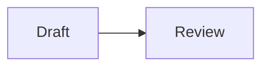

# NoteHub Markdown Guide

Write notes in Markdown, embed files from your Space, and add diagrams with Mermaid, Infographic, or a linked D2 file.

## Contents

- [Write a Markdown note](#write-a-markdown-note)
- [Write LaTeX equations](#write-latex-equations)
- [Link to files and folders](#link-to-files-and-folders)
- [Images, diagrams, and audio](#images-diagrams-and-audio)
- [Draw a Mermaid diagram](#draw-a-mermaid-diagram)
- [Build an infographic](#build-an-infographic)
- References — [Mermaid diagrams](#mermaid-diagram-reference) · [Infographic templates](#infographic-templates) · [D2](#d2-reference)

## Write a Markdown note

Save notes with the extension `.md` or `.markdown`. The preview supports task lists, tables, and footnotes.

```markdown
# Meeting notes

- [ ] Review the proposal.
```

To show document properties, start the file with a YAML mapping between two lines containing `---`. To add a collapsible section, use the following markup.

```markdown
<details>
<summary>Meeting notes</summary>

- Review the proposal.

</details>
```

## Write LaTeX equations

Use `$...$` for an inline equation. For a displayed equation, put the opening and closing `$$` on their own lines. Escape a literal dollar sign as `\$` when writing prices alongside equations.

```markdown
The price is \$15 and the quantity is $n$.

$$
\frac{a}{b} + c
$$
```

## Link to files and folders

Use a target such as `daily:/project/README.md` in MCP and CLI commands. Inside Markdown, use paths within the same Space. Resolve `./` and `../` from the document’s folder and `/` from the Space root. Include the exact filename and extension.

In a Space-root `README.md`, these links open the project folder and its README respectively. The web folder view displays the file list and previews its README. Incoming links are counted for the target you link to.

```markdown
[Project folder](./project/)
[Project README](./project/README.md)
```

## Images, diagrams, and audio

### Embed or open a D2 diagram

With `flow.d2` beside your note, use image syntax to render the diagram as SVG or a regular link to open its viewer.

```markdown
# Request flow


[Open the diagram](./flow.d2)
```

A fenced `d2` block displays the source code. To write the diagram itself, see the [D2 reference](#d2-reference).

### Embed an image or audio recording

Upload the attachments to the same Space first. If `assets/overview.png` and `recordings/meeting.webm` are under the folder containing your note, put the following source in the note to show the image and audio player. The `audio` block takes one file path on its own line.

````markdown


```audio
./recordings/meeting.webm
```
````

## Draw a Mermaid diagram

Start a fenced block with `mermaid`. The first line inside the block selects the diagram type. For example, `flowchart LR` draws a flowchart from left to right.

````markdown

````

[All Mermaid diagram types, declarations and official examples for this version](#mermaid-diagram-reference)

## Build an infographic

Use `infographic` as the fence language and `infographic <template ID>` as the first line inside it. Choose a chart, list, sequence, hierarchy, comparison, or relationship template and use its data key. The bar chart below uses `values`. [All template IDs and examples by category](#infographic-templates)

````markdown
```infographic
infographic chart-bar-plain-text
data
  title Notes this week
  desc Documents written by category
  values
    - label Meeting notes
      value 12
    - label Work notes
      value 18
    - label Research
      value 9
    - label Retrospectives
      value 6
```
````

## Mermaid diagram reference

NoteHub uses Mermaid 12.3.0. In a Markdown document, use a `mermaid` fence and start the diagram source with the declaration for the type you choose. Copy the declaration exactly, including capitalization and any `-beta` suffix shown. Each row links to the official syntax and an example in the 12.3.0 source.

````markdown

````

[Official syntax overview](https://mermaid.js.org/intro/syntax-reference.html) · [Live Editor](https://mermaid.live/)

### Flows and interactions

| Diagram | Declaration | Official syntax and examples |
| --- | --- | --- |
| Flowchart | `flowchart` | [Syntax](https://mermaid.js.org/syntax/flowchart.html) · [Example](https://github.com/mermaid-js/mermaid/blob/mermaid%4012.3.0/packages/mermaid/src/docs/syntax/flowchart.md#L688-L689) |
| Swimlanes | `swimlane-beta` | [Syntax](https://mermaid.js.org/syntax/swimlanes.html) · [Example](https://github.com/mermaid-js/mermaid/blob/mermaid%4012.3.0/packages/mermaid/src/docs/syntax/swimlanes.md#L136-L140) |
| Sequence | `sequenceDiagram` | [Syntax](https://mermaid.js.org/syntax/sequenceDiagram.html) · [Example](https://github.com/mermaid-js/mermaid/blob/mermaid%4012.3.0/packages/mermaid/src/docs/syntax/sequenceDiagram.md#L435-L437) |
| Agentflow | `agentflow-beta` | [Syntax](https://mermaid.js.org/syntax/agentflow.html) · [Example](https://github.com/mermaid-js/mermaid/blob/mermaid%4012.3.0/packages/mermaid/src/docs/syntax/agentflow.md#L176-L187) |
| Event modeling | `eventmodeling` | [Syntax](https://mermaid.js.org/syntax/eventmodeling.html) · [Example](https://github.com/mermaid-js/mermaid/blob/mermaid%4012.3.0/packages/mermaid/src/docs/syntax/eventmodeling.md#L42-L46) |
| State | `stateDiagram-v2` | [Syntax](https://mermaid.js.org/syntax/stateDiagram.html) · [Example](https://github.com/mermaid-js/mermaid/blob/mermaid%4012.3.0/packages/mermaid/src/docs/syntax/stateDiagram.md#L104-L105) |
| User journey | `journey` | [Syntax](https://mermaid.js.org/syntax/userJourney.html) · [Example](https://github.com/mermaid-js/mermaid/blob/mermaid%4012.3.0/packages/mermaid/src/docs/syntax/userJourney.md#L12-L20) |

### Software and systems

| Diagram | Declaration | Official syntax and examples |
| --- | --- | --- |
| Class | `classDiagram` | [Syntax](https://mermaid.js.org/syntax/classDiagram.html) · [Example](https://github.com/mermaid-js/mermaid/blob/mermaid%4012.3.0/packages/mermaid/src/docs/syntax/classDiagram.md#L367-L368) |
| Entity relationship | `erDiagram` | [Syntax](https://mermaid.js.org/syntax/entityRelationshipDiagram.html) · [Example](https://github.com/mermaid-js/mermaid/blob/mermaid%4012.3.0/packages/mermaid/src/docs/syntax/entityRelationshipDiagram.md#L154-L155) |
| Requirements | `requirementDiagram` | [Syntax](https://mermaid.js.org/syntax/requirementDiagram.html) · [Example](https://github.com/mermaid-js/mermaid/blob/mermaid%4012.3.0/packages/mermaid/src/docs/syntax/requirementDiagram.md#L145-L152) |
| Use case | `usecase-beta` | [Syntax](https://mermaid.js.org/syntax/usecase.html) · [Example](https://github.com/mermaid-js/mermaid/blob/mermaid%4012.3.0/packages/mermaid/src/docs/syntax/usecase.md#L259-L262) |
| Architecture | `architecture-beta` | [Syntax](https://mermaid.js.org/syntax/architecture.html) · [Example](https://github.com/mermaid-js/mermaid/blob/mermaid%4012.3.0/packages/mermaid/src/docs/syntax/architecture.md#L170-L178) |
| C4 | `C4Dynamic`, `C4Component`, `C4Container`, `C4Context`, `C4Deployment` | [Syntax](https://mermaid.js.org/syntax/c4.html) · [C4Dynamic](https://github.com/mermaid-js/mermaid/blob/mermaid%4012.3.0/packages/mermaid/src/docs/syntax/c4.md#L312-L327) · [C4Component](https://github.com/mermaid-js/mermaid/blob/mermaid%4012.3.0/packages/mermaid/src/docs/syntax/c4.md#L270-L305) · [C4Container](https://github.com/mermaid-js/mermaid/blob/mermaid%4012.3.0/packages/mermaid/src/docs/syntax/c4.md#L228-L263) · [C4Context](https://github.com/mermaid-js/mermaid/blob/mermaid%4012.3.0/packages/mermaid/src/docs/syntax/c4.md#L10-L51) · [C4Deployment](https://github.com/mermaid-js/mermaid/blob/mermaid%4012.3.0/packages/mermaid/src/docs/syntax/c4.md#L334-L381) |
| Block | `block` | [Syntax](https://mermaid.js.org/syntax/block.html) · [Example](https://github.com/mermaid-js/mermaid/blob/mermaid%4012.3.0/packages/mermaid/src/docs/syntax/block.md#L66-L67) |
| Git graph | `gitGraph` | [Syntax](https://mermaid.js.org/syntax/gitgraph.html) · [Example](https://github.com/mermaid-js/mermaid/blob/mermaid%4012.3.0/packages/mermaid/src/docs/syntax/gitgraph.md#L55-L58) |
| Packet | `packet` | [Syntax](https://mermaid.js.org/syntax/packet.html) · [Example](https://github.com/mermaid-js/mermaid/blob/mermaid%4012.3.0/packages/mermaid/src/docs/syntax/packet.md#L63-L69) |
| Railroad | `railroad-ebnf-beta`, `railroad-abnf-beta`, `railroad-peg-beta`, `railroad-beta` | [Syntax](https://github.com/mermaid-js/mermaid/blob/mermaid%4012.3.0/packages/mermaid/src/docs/syntax/railroad.md) · [railroad-ebnf-beta](https://github.com/mermaid-js/mermaid/blob/mermaid%4012.3.0/packages/mermaid/src/docs/syntax/railroad.md#L76-L77) · [railroad-abnf-beta](https://github.com/mermaid-js/mermaid/blob/mermaid%4012.3.0/packages/mermaid/src/docs/syntax/railroad.md#L208-L213) · [railroad-peg-beta](https://github.com/mermaid-js/mermaid/blob/mermaid%4012.3.0/packages/mermaid/src/docs/syntax/railroad.md#L241-L246) · [railroad-beta](https://github.com/mermaid-js/mermaid/blob/mermaid%4012.3.0/packages/mermaid/src/docs/syntax/railroad.md#L265-L287) |

### Planning and analysis

| Diagram | Declaration | Official syntax and examples |
| --- | --- | --- |
| Gantt | `gantt` | [Syntax](https://mermaid.js.org/syntax/gantt.html) · [Example](https://github.com/mermaid-js/mermaid/blob/mermaid%4012.3.0/packages/mermaid/src/docs/syntax/gantt.md?plain=1#L24-L32) |
| Timeline | `timeline` | [Syntax](https://mermaid.js.org/syntax/timeline.html) · [Example](https://github.com/mermaid-js/mermaid/blob/mermaid%4012.3.0/packages/mermaid/src/docs/syntax/timeline.md#L52-L57) |
| Kanban | `kanban` | [Syntax](https://mermaid.js.org/syntax/kanban.html) · [Example](https://github.com/mermaid-js/mermaid/blob/mermaid%4012.3.0/packages/mermaid/src/docs/syntax/kanban.md#L14-L16) |
| Mindmap | `mindmap` | [Syntax](https://mermaid.js.org/syntax/mindmap.html) · [Example](https://github.com/mermaid-js/mermaid/blob/mermaid%4012.3.0/packages/mermaid/src/docs/syntax/mindmap.md#L95-L96) |
| TreeView | `treeView-beta` | [Syntax](https://mermaid.js.org/syntax/treeView.html) · [Example](https://github.com/mermaid-js/mermaid/blob/mermaid%4012.3.0/packages/mermaid/src/docs/syntax/treeView.md#L219-L223) |
| Ishikawa | `ishikawa-beta` | [Syntax](https://mermaid.js.org/syntax/ishikawa.html) · [Example](https://github.com/mermaid-js/mermaid/blob/mermaid%4012.3.0/packages/mermaid/src/docs/syntax/ishikawa.md#L14-L33) |
| Wardley map | `wardley-beta` | [Syntax](https://mermaid.js.org/syntax/wardley.html) · [Example](https://github.com/mermaid-js/mermaid/blob/mermaid%4012.3.0/packages/mermaid/src/docs/syntax/wardley.md?plain=1#L30-L49) |
| Cynefin | `cynefin-beta` | [Syntax](https://mermaid.js.org/syntax/cynefin.html) · [Example](https://github.com/mermaid-js/mermaid/blob/mermaid%4012.3.0/packages/mermaid/src/docs/syntax/cynefin.md#L153-L159) |

### Charts and sets

| Diagram | Declaration | Official syntax and examples |
| --- | --- | --- |
| Pie | `pie` | [Syntax](https://mermaid.js.org/syntax/pie.html) · [Example](https://github.com/mermaid-js/mermaid/blob/mermaid%4012.3.0/packages/mermaid/src/docs/syntax/pie.md#L13-L16) |
| XY chart | `xychart` | [Syntax](https://mermaid.js.org/syntax/xyChart.html) · [Example](https://github.com/mermaid-js/mermaid/blob/mermaid%4012.3.0/packages/mermaid/src/docs/syntax/xyChart.md#L254-L258) |
| Quadrant | `quadrantChart` | [Syntax](https://mermaid.js.org/syntax/quadrantChart.html) · [Example](https://github.com/mermaid-js/mermaid/blob/mermaid%4012.3.0/packages/mermaid/src/docs/syntax/quadrantChart.md#L12-L25) |
| Sankey | `sankey` | [Syntax](https://mermaid.js.org/syntax/sankey.html) · [Example](https://github.com/mermaid-js/mermaid/blob/mermaid%4012.3.0/packages/mermaid/src/docs/syntax/sankey.md#L120-L126) |
| Radar | `radar-beta` | [Syntax](https://mermaid.js.org/syntax/radar.html) · [Example](https://github.com/mermaid-js/mermaid/blob/mermaid%4012.3.0/packages/mermaid/src/docs/syntax/radar.md#L50-L61) |
| Treemap | `treemap-beta` | [Syntax](https://mermaid.js.org/syntax/treemap.html) · [Example](https://github.com/mermaid-js/mermaid/blob/mermaid%4012.3.0/packages/mermaid/src/docs/syntax/treemap.md#L49-L55) |
| Venn | `venn-beta` | [Syntax](https://mermaid.js.org/syntax/venn.html) · [Example](https://github.com/mermaid-js/mermaid/blob/mermaid%4012.3.0/packages/mermaid/src/docs/syntax/venn.md#L82-L85) |

### Alternate declarations

The following declarations also rendered in NoteHub’s frame.

| Preferred | Also accepted |
| --- | --- |
| `flowchart` | `graph`, `flowchart-elk` |
| `classDiagram` | `classDiagram-v2` |
| `stateDiagram-v2` | `stateDiagram` |
| `block` | `block-beta` |
| `packet` | `packet-beta` |
| `sankey` | `sankey-beta` |
| `xychart` | `xychart-beta` |
| `ishikawa-beta` | `ishikawa` |
| `treemap-beta` | `treemap` |

### Renderer scope

- `info` displays Mermaid version information.

- ZenUML requires a separate plugin. NoteHub 12.3.0-based previews support the built-in `sequenceDiagram` syntax for message exchanges. [ZenUML](https://mermaid.js.org/syntax/zenuml.html)

## Infographic templates

NoteHub uses the built-in registry from `@antv/infographic@0.2.20`. Copy an exact ID below. The six categories contain 273 template IDs. Three additional IDs are deprecated aliases.

Choose a category below, copy its Markdown example, and replace the template ID and data. The ID selects the layout. The data key determines how to supply its items.

To compare layouts, search the [AntV gallery](https://infographic.antv.vision/gallery) by template ID. For field definitions, see the [syntax guide](https://infographic.antv.vision/learn/infographic-syntax) and [data reference](https://infographic.antv.vision/learn/data).

### Template index

| Category | Data key | Templates |
| --- | --- | ---: |
| [Numeric charts](#chart) | `values` | 11 |
| [Lists](#list) | `lists` | 29 |
| [Sequences](#sequence) | `sequences` | 83 |
| [Hierarchies](#hierarchy) | `root` | 112 |
| [Comparisons and quadrants](#compare) | `compares` | 20 |
| [Relationships](#relation) | `nodes + relations` | 18 |

Each example is a complete Markdown block. IDs below it are grouped by their registered layout.

### chart

Choose a bar, column, line, pie, donut, or word cloud template.

````markdown
```infographic
infographic chart-bar-plain-text
data
  values
    - label Notes
      value 12
    - label Tasks
      value 8
```
````

#### chart-bar

- `chart-bar-plain-text`

#### chart-column

- `chart-column-simple`

#### chart-line

- `chart-line-plain-text`

#### chart-pie

- `chart-pie-compact-card`
- `chart-pie-donut-compact-card`
- `chart-pie-donut-pill-badge`
- `chart-pie-donut-plain-text`
- `chart-pie-pill-badge`
- `chart-pie-plain-text`

#### chart-wordcloud

- `chart-wordcloud`
- `chart-wordcloud-rotate`

### list

````markdown
```infographic
infographic list-row-simple-horizontal-arrow
data
  lists
    - label Notes
    - label Tasks
```
````

#### list-column

- `list-column-done-list`
- `list-column-simple-vertical-arrow`
- `list-column-vertical-icon-arrow`

#### list-grid

- `list-grid-badge-card`
- `list-grid-candy-card-lite`
- `list-grid-circular-progress`
- `list-grid-compact-card`
- `list-grid-done-list`
- `list-grid-horizontal-icon-arrow`
- `list-grid-progress-card`
- `list-grid-ribbon-card`
- `list-grid-simple`

#### list-pyramid

- `list-pyramid-badge-card`
- `list-pyramid-compact-card`
- `list-pyramid-rounded-rect-node`

#### list-row

- `list-row-circular-progress`
- `list-row-horizontal-icon-arrow`
- `list-row-horizontal-icon-line`
- `list-row-simple-horizontal-arrow`
- `list-row-simple-illus`

#### list-sector

- `list-sector-half-plain-text`
- `list-sector-plain-text`
- `list-sector-simple`

#### list-waterfall

- `list-waterfall-badge-card`
- `list-waterfall-compact-card`

#### list-zigzag-down

- `list-zigzag-down-compact-card`
- `list-zigzag-down-simple`

#### list-zigzag-up

- `list-zigzag-up-compact-card`
- `list-zigzag-up-simple`

### sequence

````markdown
```infographic
infographic sequence-timeline-simple
data
  sequences
    - label Draft
    - label Publish
```
````

#### sequence-ascending-stairs-3d

- `sequence-ascending-stairs-3d-simple`
- `sequence-ascending-stairs-3d-underline-text`

#### sequence-ascending-steps

- `sequence-ascending-steps`

#### sequence-circle-arrows

- `sequence-circle-arrows-indexed-card`

#### sequence-circular

- `sequence-circular-simple`
- `sequence-circular-underline-text`

#### sequence-color-snake-steps

- `sequence-color-snake-steps-horizontal-icon-line`
- `sequence-color-snake-steps-simple-illus`

#### sequence-cylinders-3d

- `sequence-cylinders-3d-simple`

#### sequence-filter-mesh

- `sequence-filter-mesh-simple`
- `sequence-filter-mesh-underline-text`

#### sequence-funnel

- `sequence-funnel-simple`

#### sequence-horizontal-zigzag

- `sequence-horizontal-zigzag-horizontal-icon-line`
- `sequence-horizontal-zigzag-plain-text`
- `sequence-horizontal-zigzag-simple`
- `sequence-horizontal-zigzag-simple-horizontal-arrow`
- `sequence-horizontal-zigzag-simple-illus`
- `sequence-horizontal-zigzag-underline-text`

#### sequence-interaction

Each entry in `sequences` is a lane. Give its steps IDs under `children`, then connect two step IDs with a labeled message in `relations`.

````markdown
```infographic
infographic sequence-interaction-compact-badge-card
data
  sequences
    - label Browser
      children
        - id submit
          label Submit
    - label Server
      children
        - id store
          label Store
  relations
    - from submit
      to store
      label Save note
```
````

- `sequence-interaction-compact-animated-badge-card`
- `sequence-interaction-compact-animated-capsule-item`
- `sequence-interaction-compact-animated-compact-card`
- `sequence-interaction-compact-animated-rounded-rect-node`
- `sequence-interaction-compact-badge-card`
- `sequence-interaction-compact-capsule-item`
- `sequence-interaction-compact-compact-card`
- `sequence-interaction-compact-dashed-badge-card`
- `sequence-interaction-compact-dashed-capsule-item`
- `sequence-interaction-compact-dashed-compact-card`
- `sequence-interaction-compact-dashed-rounded-rect-node`
- `sequence-interaction-compact-rounded-rect-node`
- `sequence-interaction-default-animated-badge-card`
- `sequence-interaction-default-animated-capsule-item`
- `sequence-interaction-default-animated-compact-card`
- `sequence-interaction-default-animated-rounded-rect-node`
- `sequence-interaction-default-badge-card`
- `sequence-interaction-default-capsule-item`
- `sequence-interaction-default-compact-card`
- `sequence-interaction-default-dashed-badge-card`
- `sequence-interaction-default-dashed-capsule-item`
- `sequence-interaction-default-dashed-compact-card`
- `sequence-interaction-default-dashed-rounded-rect-node`
- `sequence-interaction-default-rounded-rect-node`
- `sequence-interaction-wide-animated-badge-card`
- `sequence-interaction-wide-animated-capsule-item`
- `sequence-interaction-wide-animated-compact-card`
- `sequence-interaction-wide-animated-rounded-rect-node`
- `sequence-interaction-wide-badge-card`
- `sequence-interaction-wide-capsule-item`
- `sequence-interaction-wide-compact-card`
- `sequence-interaction-wide-dashed-badge-card`
- `sequence-interaction-wide-dashed-capsule-item`
- `sequence-interaction-wide-dashed-compact-card`
- `sequence-interaction-wide-dashed-rounded-rect-node`
- `sequence-interaction-wide-rounded-rect-node`

#### sequence-mountain

- `sequence-mountain-underline-text`

#### sequence-pyramid

- `sequence-pyramid-simple`

#### sequence-roadmap-vertical

- `sequence-roadmap-vertical-badge-card`
- `sequence-roadmap-vertical-pill-badge`
- `sequence-roadmap-vertical-plain-text`
- `sequence-roadmap-vertical-quarter-circular`
- `sequence-roadmap-vertical-quarter-simple-card`
- `sequence-roadmap-vertical-simple`
- `sequence-roadmap-vertical-underline-text`

#### sequence-snake-steps

- `sequence-snake-steps-compact-card`
- `sequence-snake-steps-pill-badge`
- `sequence-snake-steps-simple`
- `sequence-snake-steps-simple-illus`
- `sequence-snake-steps-underline-text`

#### sequence-stairs-front

- `sequence-stairs-front-compact-card`
- `sequence-stairs-front-pill-badge`
- `sequence-stairs-front-simple`

#### sequence-steps

- `sequence-steps-badge-card`
- `sequence-steps-simple`
- `sequence-steps-simple-illus`

#### sequence-timeline

- `sequence-timeline-done-list`
- `sequence-timeline-plain-text`
- `sequence-timeline-rounded-rect-node`
- `sequence-timeline-simple`
- `sequence-timeline-simple-illus`

#### sequence-zigzag-pucks-3d

- `sequence-zigzag-pucks-3d-indexed-card`
- `sequence-zigzag-pucks-3d-simple`
- `sequence-zigzag-pucks-3d-underline-text`

#### sequence-zigzag-steps

- `sequence-zigzag-steps-underline-text`

### hierarchy

````markdown
```infographic
infographic hierarchy-tree-curved-line-compact-card
data
  root
    label Workspace
    children
      - label Notes
      - label Tasks
```
````

#### hierarchy-mindmap

- `hierarchy-mindmap-branch-gradient-capsule-item`
- `hierarchy-mindmap-branch-gradient-circle-progress`
- `hierarchy-mindmap-branch-gradient-compact-card`
- `hierarchy-mindmap-branch-gradient-lined-palette`
- `hierarchy-mindmap-branch-gradient-rounded-rect`
- `hierarchy-mindmap-level-gradient-capsule-item`
- `hierarchy-mindmap-level-gradient-circle-progress`
- `hierarchy-mindmap-level-gradient-compact-card`
- `hierarchy-mindmap-level-gradient-lined-palette`
- `hierarchy-mindmap-level-gradient-rounded-rect`

#### hierarchy-structure

- `hierarchy-structure`
- `hierarchy-structure-mirror`

#### hierarchy-tree

- `hierarchy-tree-bt-curved-line-badge-card`
- `hierarchy-tree-bt-curved-line-capsule-item`
- `hierarchy-tree-bt-curved-line-compact-card`
- `hierarchy-tree-bt-curved-line-ribbon-card`
- `hierarchy-tree-bt-curved-line-rounded-rect-node`
- `hierarchy-tree-bt-dashed-arrow-badge-card`
- `hierarchy-tree-bt-dashed-arrow-capsule-item`
- `hierarchy-tree-bt-dashed-arrow-compact-card`
- `hierarchy-tree-bt-dashed-arrow-ribbon-card`
- `hierarchy-tree-bt-dashed-arrow-rounded-rect-node`
- `hierarchy-tree-bt-dashed-line-badge-card`
- `hierarchy-tree-bt-dashed-line-capsule-item`
- `hierarchy-tree-bt-dashed-line-compact-card`
- `hierarchy-tree-bt-dashed-line-ribbon-card`
- `hierarchy-tree-bt-dashed-line-rounded-rect-node`
- `hierarchy-tree-bt-distributed-origin-badge-card`
- `hierarchy-tree-bt-distributed-origin-capsule-item`
- `hierarchy-tree-bt-distributed-origin-compact-card`
- `hierarchy-tree-bt-distributed-origin-ribbon-card`
- `hierarchy-tree-bt-distributed-origin-rounded-rect-node`
- `hierarchy-tree-bt-tech-style-badge-card`
- `hierarchy-tree-bt-tech-style-capsule-item`
- `hierarchy-tree-bt-tech-style-compact-card`
- `hierarchy-tree-bt-tech-style-ribbon-card`
- `hierarchy-tree-bt-tech-style-rounded-rect-node`
- `hierarchy-tree-curved-line-badge-card`
- `hierarchy-tree-curved-line-capsule-item`
- `hierarchy-tree-curved-line-compact-card`
- `hierarchy-tree-curved-line-ribbon-card`
- `hierarchy-tree-curved-line-rounded-rect-node`
- `hierarchy-tree-dashed-arrow-badge-card`
- `hierarchy-tree-dashed-arrow-capsule-item`
- `hierarchy-tree-dashed-arrow-compact-card`
- `hierarchy-tree-dashed-arrow-ribbon-card`
- `hierarchy-tree-dashed-arrow-rounded-rect-node`
- `hierarchy-tree-dashed-line-badge-card`
- `hierarchy-tree-dashed-line-capsule-item`
- `hierarchy-tree-dashed-line-compact-card`
- `hierarchy-tree-dashed-line-ribbon-card`
- `hierarchy-tree-dashed-line-rounded-rect-node`
- `hierarchy-tree-distributed-origin-badge-card`
- `hierarchy-tree-distributed-origin-capsule-item`
- `hierarchy-tree-distributed-origin-compact-card`
- `hierarchy-tree-distributed-origin-ribbon-card`
- `hierarchy-tree-distributed-origin-rounded-rect-node`
- `hierarchy-tree-lr-curved-line-badge-card`
- `hierarchy-tree-lr-curved-line-capsule-item`
- `hierarchy-tree-lr-curved-line-compact-card`
- `hierarchy-tree-lr-curved-line-ribbon-card`
- `hierarchy-tree-lr-curved-line-rounded-rect-node`
- `hierarchy-tree-lr-dashed-arrow-badge-card`
- `hierarchy-tree-lr-dashed-arrow-capsule-item`
- `hierarchy-tree-lr-dashed-arrow-compact-card`
- `hierarchy-tree-lr-dashed-arrow-ribbon-card`
- `hierarchy-tree-lr-dashed-arrow-rounded-rect-node`
- `hierarchy-tree-lr-dashed-line-badge-card`
- `hierarchy-tree-lr-dashed-line-capsule-item`
- `hierarchy-tree-lr-dashed-line-compact-card`
- `hierarchy-tree-lr-dashed-line-ribbon-card`
- `hierarchy-tree-lr-dashed-line-rounded-rect-node`
- `hierarchy-tree-lr-distributed-origin-badge-card`
- `hierarchy-tree-lr-distributed-origin-capsule-item`
- `hierarchy-tree-lr-distributed-origin-compact-card`
- `hierarchy-tree-lr-distributed-origin-ribbon-card`
- `hierarchy-tree-lr-distributed-origin-rounded-rect-node`
- `hierarchy-tree-lr-tech-style-badge-card`
- `hierarchy-tree-lr-tech-style-capsule-item`
- `hierarchy-tree-lr-tech-style-compact-card`
- `hierarchy-tree-lr-tech-style-ribbon-card`
- `hierarchy-tree-lr-tech-style-rounded-rect-node`
- `hierarchy-tree-rl-curved-line-badge-card`
- `hierarchy-tree-rl-curved-line-capsule-item`
- `hierarchy-tree-rl-curved-line-compact-card`
- `hierarchy-tree-rl-curved-line-ribbon-card`
- `hierarchy-tree-rl-curved-line-rounded-rect-node`
- `hierarchy-tree-rl-dashed-arrow-badge-card`
- `hierarchy-tree-rl-dashed-arrow-capsule-item`
- `hierarchy-tree-rl-dashed-arrow-compact-card`
- `hierarchy-tree-rl-dashed-arrow-ribbon-card`
- `hierarchy-tree-rl-dashed-arrow-rounded-rect-node`
- `hierarchy-tree-rl-dashed-line-badge-card`
- `hierarchy-tree-rl-dashed-line-capsule-item`
- `hierarchy-tree-rl-dashed-line-compact-card`
- `hierarchy-tree-rl-dashed-line-ribbon-card`
- `hierarchy-tree-rl-dashed-line-rounded-rect-node`
- `hierarchy-tree-rl-distributed-origin-badge-card`
- `hierarchy-tree-rl-distributed-origin-capsule-item`
- `hierarchy-tree-rl-distributed-origin-compact-card`
- `hierarchy-tree-rl-distributed-origin-ribbon-card`
- `hierarchy-tree-rl-distributed-origin-rounded-rect-node`
- `hierarchy-tree-rl-tech-style-badge-card`
- `hierarchy-tree-rl-tech-style-capsule-item`
- `hierarchy-tree-rl-tech-style-compact-card`
- `hierarchy-tree-rl-tech-style-ribbon-card`
- `hierarchy-tree-rl-tech-style-rounded-rect-node`
- `hierarchy-tree-tech-style-badge-card`
- `hierarchy-tree-tech-style-capsule-item`
- `hierarchy-tree-tech-style-compact-card`
- `hierarchy-tree-tech-style-ribbon-card`
- `hierarchy-tree-tech-style-rounded-rect-node`

### compare

````markdown
```infographic
infographic compare-binary-horizontal-compact-card-vs
data
  compares
    - label Before
    - label After
```
````

#### compare-binary-horizontal

- `compare-binary-horizontal-badge-card-arrow`
- `compare-binary-horizontal-badge-card-fold`
- `compare-binary-horizontal-badge-card-vs`
- `compare-binary-horizontal-compact-card-arrow`
- `compare-binary-horizontal-compact-card-fold`
- `compare-binary-horizontal-compact-card-vs`
- `compare-binary-horizontal-simple-arrow`
- `compare-binary-horizontal-simple-fold`
- `compare-binary-horizontal-simple-vs`
- `compare-binary-horizontal-underline-text-arrow`
- `compare-binary-horizontal-underline-text-fold`
- `compare-binary-horizontal-underline-text-vs`

#### compare-hierarchy-left-right

- `compare-hierarchy-left-right-circle-node-pill-badge`
- `compare-hierarchy-left-right-circle-node-plain-text`

#### compare-hierarchy-row

- `compare-hierarchy-row-letter-card-compact-card`
- `compare-hierarchy-row-letter-card-rounded-rect-node`
- `compare-swot`

#### quadrant

- `compare-quadrant-quarter-circular`
- `compare-quadrant-quarter-simple-card`
- `compare-quadrant-simple-illus`

### relation

````markdown
```infographic
infographic relation-dagre-flow-lr-compact-card
data
  nodes
    - id client
      label Client
    - id api
      label API
  relations
    - from client
      to api
```
````

#### relation-circle

- `relation-circle-circular-progress`
- `relation-circle-icon-badge`

#### relation-dagre-flow

- `relation-dagre-flow-lr-animated-badge-card`
- `relation-dagre-flow-lr-animated-capsule`
- `relation-dagre-flow-lr-animated-compact-card`
- `relation-dagre-flow-lr-animated-simple-circle-node`
- `relation-dagre-flow-lr-badge-card`
- `relation-dagre-flow-lr-compact-card`
- `relation-dagre-flow-lr-simple-circle-node`
- `relation-dagre-flow-tb-animated-badge-card`
- `relation-dagre-flow-tb-animated-capsule`
- `relation-dagre-flow-tb-animated-compact-card`
- `relation-dagre-flow-tb-animated-simple-circle-node`
- `relation-dagre-flow-tb-badge-card`
- `relation-dagre-flow-tb-compact-card`
- `relation-dagre-flow-tb-simple-circle-node`

#### relation-network

- `relation-network-icon-badge`
- `relation-network-simple-circle-node`

### Deprecated aliases

Use the corresponding `compare-quadrant-*` ID in new documents.

| Alias | Use |
| --- | --- |
| `quadrant-quarter-circular` | `compare-quadrant-quarter-circular` |
| `quadrant-quarter-simple-card` | `compare-quadrant-quarter-simple-card` |
| `quadrant-simple-illus` | `compare-quadrant-simple-illus` |

## D2 reference

Save this source as `flow.d2` in the same folder as your Markdown note. Omit the Markdown fences.

```d2
client: Browser
api: NoteHub
client -> api: Send request
```

This reference covers NoteHub renderer **0.1.1**, D2 **0.9.0**, and the **Dagre** layout engine. File imports are disabled. [Renderer configuration](../../services/renderer/render.go) · [D2 dependency](../../services/renderer/go.mod)

- [Shapes](#shapes)
- [Connections and arrowheads](#connections)
- [Layout](#layout)

### Shapes

Set `shape` on a node. A node with no explicit shape uses `rectangle`.

| Use | Values | Official syntax and examples |
| --- | --- | --- |
| Geometry | `rectangle`, `square`, `oval`, `circle`, `diamond`, `hexagon`, `parallelogram` | [Shape catalog](https://d2lang.com/tour/shapes/) |
| Documents and annotations | `page`, `document`, `callout` | [Shape examples](https://d2lang.com/tour/shapes/#example) |
| Storage and infrastructure | `cylinder`, `stored_data`, `queue`, `package`, `cloud` | [Shape catalog](https://d2lang.com/tour/shapes/) |
| People and steps | `person`, `c4-person`, `step` | [Shape catalog](https://d2lang.com/tour/shapes/) |
| Text and code | `text`, `code` | [Text and code blocks](https://d2lang.com/tour/text/) |
| UML class and database table | `class`, `sql_table` | [UML classes](https://d2lang.com/tour/uml-classes/) · [SQL tables](https://d2lang.com/tour/sql-tables/) |
| Image | `image` (set `icon` to the image URL) | [Icons and images](https://d2lang.com/tour/icons/) |
| Sequence | `sequence_diagram` | [Sequence diagram examples](https://d2lang.com/tour/sequence-diagrams/) |
| Hierarchy container | `hierarchy` | [v0.9.0 shape registry](https://github.com/d2lang/d2/blob/v0.9.0/d2target/d2target.go#L1244-L1298) · [Containers](https://d2lang.com/tour/containers/) |

```d2
reader: Reader {shape: person}
store: Archive {shape: cylinder}
reader -> store: Save note
```

An `image` shape can compile to SVG containing an image reference. Displaying that resource depends on the viewer's image policy. The `hierarchy` shape is accepted by the compiler; NoteHub uses Dagre for graph placement.

### Connections

Connect **node keys**. Add a label after `:`. [Connection syntax and examples](https://d2lang.com/tour/connections/)

| D2 | Result |
| --- | --- |
| `a -- b` | Line without arrowheads |
| `a -> b` | Arrow toward `b` |
| `a <- b` | Arrow toward `a` |
| `a <-> b` | Arrows at both ends |

Choose an arrowhead on an end that has an arrow. Set `source-arrowhead.shape` on the source or `target-arrowhead.shape` on the target. [Arrowhead examples](https://d2lang.com/tour/connections/#arrowheads)

| Use | Values |
| --- | --- |
| Standard ends | `triangle` (default), `arrow`, `diamond`, `circle`, `box`, `cross`, `none` |
| Entity cardinality | `cf-one`, `cf-one-required`, `cf-many`, `cf-many-required` |

```d2
author <-> note: owns {
  source-arrowhead.shape: cf-one-required
  target-arrowhead.shape: cf-many
  style.stroke-dash: 4
}
```

Use `style.filled: false` on a triangle arrowhead for an outline, or `style.filled: true` on a diamond, circle, or box for a solid end. Edge styles such as `style.stroke-dash` belong on the connection. [Styles](https://d2lang.com/tour/style/) · [Chains, repeated edges and indexed references](https://d2lang.com/tour/connections/)

### Layout

NoteHub resolves graph layout to **Dagre**. The source can choose flow direction and organize nodes into containers, grids, or sequence diagrams. ELK and TALA are upstream engine options; this service always selects Dagre. [Dagre examples](https://d2lang.com/tour/dagre/) · [Upstream engine comparison](https://d2lang.com/tour/layouts/)

| Intent | Source | Official examples |
| --- | --- | --- |
| Flow direction | Top-level `direction: down` (default), `up`, `left`, `right` | [Layouts](https://d2lang.com/tour/layouts/) |
| Group nodes | Nest children in `group: { ... }`; connect by path, e.g. `group.api` | [Containers](https://d2lang.com/tour/containers/) |
| Grid | Set `grid-columns` or `grid-rows` on the grid | [Grid diagrams](https://d2lang.com/tour/grid-diagrams/) |
| Ordered messages | Set `shape: sequence_diagram`; write the messages in order | [Sequence diagrams](https://d2lang.com/tour/sequence-diagrams/) |
| Anchor a title or legend | Use a constant such as `near: top-center` on a separate node | [Positioning examples](https://d2lang.com/tour/positions/) |

```d2
direction: right
client -> services.api: Request
services: {
  api -> db
  db.shape: cylinder
}
```
