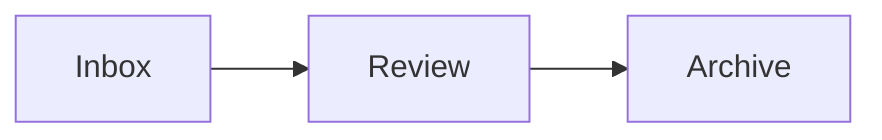

# Authoring documents in NoteHub

[한국어](document-authoring.ko.md)

Save notes as `.md` or `.markdown` text documents. Write ordinary Markdown by default. Use GitHub Flavored Markdown for tables, task lists, and footnotes. When a diagram helps, choose its format by what it needs to communicate.

| Use case | What to save |
| --- | --- |
| Prose, lists, tables, and links | A `.md` text document |
| A flowchart or sequence inside a note | A `mermaid` fenced block in the `.md` document |
| A chart or infographic inside a note | An `infographic` fenced block in the `.md` document |
| A standalone or reusable architecture diagram | A `.d2` text document |
| A D2 diagram displayed as an image in Markdown | `` |

To show document properties, start the file with a YAML mapping between two lines containing `---`. To add a collapsible section, use the following markup.

```markdown
<details>
<summary>Meeting notes</summary>

- Review the proposal.

</details>
```

## Markdown links and folder landing pages

Resolve relative links from the folder containing the Markdown document. A path starting with `/` resolves from the root of the same Space. Use the exact names of existing files, including their extensions. Use ordinary Markdown links for in-Space navigation and keep the target path within that Space.

```markdown
[Project folder](./project/)
[Project README](./project/README.md)
[Space index](/README.md)
[See the notes](#notes)

```

Place `README.md` directly inside a folder to give it a landing page. The web folder view opens on the README tab, including at the Space root. Use `[Project folder](./project/)` when readers should land in that folder and see its file list and README. Use `[Project README](./project/README.md)` to open the document directly. Incoming links follow the exact linked target, even when the two views show the same README body.

For a bundle of related materials, use a folder with a README that links to its notes and attachments. Use a single path on its own line in an `audio` block to add a player for an audio file already stored in the same Space.

`````markdown
```audio
./recording.webm
```
`````

## Mermaid

Put a diagram directly inside the note using a `mermaid` fence.



See the [Mermaid syntax reference](https://mermaid.js.org/intro/syntax-reference.html) for other diagram types.

## AntV Infographic

Use an `infographic` fence. Start with `infographic <template>` and indent the data under `data`. Choose a template that matches the data shape. For a bar chart, use `values` with a label and a numeric value per entry.

```infographic
infographic chart-bar-plain-text
data
  title Notes this week
  desc Documents written by category
  values
    - label Meeting notes
      value 12
    - label Work notes
      value 18
    - label Research
      value 9
    - label Retrospectives
      value 6
```

See the [AntV data reference](https://infographic.antv.vision/learn/data) for additional data shapes.

## Write and embed a D2 diagram

Save [flow.d2](examples/request-flow/flow.d2) as a text document with raw D2 source. Put the [example README.md](examples/request-flow/README.md) in the same folder. In NoteHub, its image displays the rendered SVG and its link opens the standalone diagram.

```markdown


[Open the diagram](./flow.d2)
```

Use a fenced `d2` block when showing source code to the reader. Use the image syntax above when showing the diagram. In CLI and MCP commands, address the files as `<space>:/folder/flow.d2` and `<space>:/folder/README.md`. Inside the README, use the relative path.
