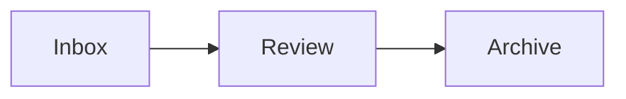

# Authoring documents in NoteHub

[한국어](document-authoring.ko.md)

## Contents

- [Markdown authoring guide](#markdown-authoring-guide)
  - [Write a note](#write-a-note)
  - [Link documents and folders](#link-documents-and-folders)
  - [Embed images and audio](#embed-images-and-audio)
  - [Write Mermaid and Infographic blocks](#write-mermaid-and-infographic-blocks)
- [D2 authoring guide](#d2-authoring-guide)

## Markdown authoring guide

### Write a note

Save the following Markdown as a text document named `notes.md`. The preview shows a heading and a task list. Use `.md` or `.markdown` for notes. Tables and footnotes use GitHub Flavored Markdown syntax.

```markdown
# Meeting notes

- [ ] Review the proposal.
```

To show document properties, start the file with a YAML mapping between two lines containing `---`. To add a collapsible section, use the following markup.

```markdown
<details>
<summary>Meeting notes</summary>

- Review the proposal.

</details>
```

### Link documents and folders

Use a target such as `daily:/project/README.md` in MCP and CLI commands. Inside Markdown, use paths within the same Space. Resolve `./` and `../` from the document’s folder and `/` from the Space root. Include the exact filename and extension.

In a Space-root `README.md`, these links open the project folder and its README respectively. The web folder view displays the file list and previews its README. Incoming links are counted for the target you link to.

```markdown
[Project folder](./project/)
[Project README](./project/README.md)
```

### Embed images and audio

Upload the attachments to the same Space first. If `assets/overview.png` and `recordings/meeting.webm` are under the folder containing your note, put the following source in the note to show the image and audio player. The `audio` block takes one file path on its own line.

````markdown


```audio
./recordings/meeting.webm
```
````

### Write Mermaid and Infographic blocks

Include the opening and closing fences in the Markdown document. Use `mermaid` for a flowchart or sequence diagram.

````markdown

````

For a bar chart, use an `infographic` block. Name the template on the first line, then indent the labels and numeric values under `data` as shown.

````markdown
```infographic
infographic chart-bar-plain-text
data
  title Notes this week
  desc Documents written by category
  values
    - label Meeting notes
      value 12
    - label Work notes
      value 18
    - label Research
      value 9
    - label Retrospectives
      value 6
```
````

For more examples, see [Mermaid](https://mermaid.js.org/intro/syntax-reference.html) · [AntV Infographic](https://infographic.antv.vision/learn/data)

## D2 authoring guide

Save [flow.d2](examples/request-flow/flow.d2) as a text document. Write the D2 source directly into the file without Markdown fences.

```d2
client: Browser
api: NoteHub
client -> api: Send request
```

Save [README.md](examples/request-flow/README.md) in the same folder with this content.

```markdown
# Request flow


[Open the diagram](./flow.d2)
```

The image renders `flow.d2` as SVG inside the note. Clicking the ordinary link opens the same file in the standalone diagram viewer. A fenced `d2` block inside Markdown displays the source code.
