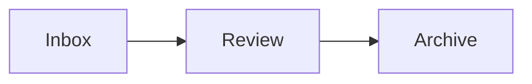

# Write documents in NoteHub

Use Markdown for notes, attachments, and inline diagrams. Use a separate D2 file when you want to embed the same diagram in several notes or open it in its own viewer.

## Contents

- [Write a Markdown note](#write-a-markdown-note)
- [Link to files and folders](#link-to-files-and-folders)
- [Embed images and audio](#embed-images-and-audio)
- [Draw a Mermaid diagram](#draw-a-mermaid-diagram)
- [Build an infographic](#build-an-infographic)
- [Embed or open a D2 diagram](#embed-or-open-a-d2-diagram)

## Write a Markdown note

Save notes with the extension `.md` or `.markdown`. The preview supports task lists, tables, and footnotes.

```markdown
# Meeting notes

- [ ] Review the proposal.
```

To show document properties, start the file with a YAML mapping between two lines containing `---`. To add a collapsible section, use the following markup.

```markdown
<details>
<summary>Meeting notes</summary>

- Review the proposal.

</details>
```

## Link to files and folders

Use a target such as `daily:/project/README.md` in MCP and CLI commands. Inside Markdown, use paths within the same Space. Resolve `./` and `../` from the document’s folder and `/` from the Space root. Include the exact filename and extension.

In a Space-root `README.md`, these links open the project folder and its README respectively. The web folder view displays the file list and previews its README. Incoming links are counted for the target you link to.

```markdown
[Project folder](./project/)
[Project README](./project/README.md)
```

## Embed images and audio

Upload the attachments to the same Space first. If `assets/overview.png` and `recordings/meeting.webm` are under the folder containing your note, put the following source in the note to show the image and audio player. The `audio` block takes one file path on its own line.

````markdown


```audio
./recordings/meeting.webm
```
````

## Draw a Mermaid diagram

Start a fenced block with `mermaid`. The first line inside the block selects the diagram type. For example, `flowchart LR` draws a flowchart from left to right.

````markdown

````

[All Mermaid diagram types, declarations and official examples for this version](mermaid-diagrams.md)

## Build an infographic

Use `infographic` as the fence language and `infographic <template ID>` as the first line inside it. Choose a chart, list, sequence, hierarchy, comparison, or relationship template and use its data key. The bar chart below uses `values`. [All template IDs and examples by category](infographic-templates.md)

````markdown
```infographic
infographic chart-bar-plain-text
data
  title Notes this week
  desc Documents written by category
  values
    - label Meeting notes
      value 12
    - label Work notes
      value 18
    - label Research
      value 9
    - label Retrospectives
      value 6
```
````

## Embed or open a D2 diagram

Save [flow.d2](examples/request-flow/flow.d2) as a text document. Write the D2 source directly into the file without Markdown fences.

```d2
client: Browser
api: NoteHub
client -> api: Send request
```

Save [README.md](examples/request-flow/README.md) in the same folder with this content.

```markdown
# Request flow


[Open the diagram](./flow.d2)
```

The image renders `flow.d2` as SVG inside the note. Clicking the ordinary link opens the same file in the standalone diagram viewer. A fenced `d2` block inside Markdown displays the source code.

[Supported shapes, connections, layouts and official examples](d2-reference.md)
