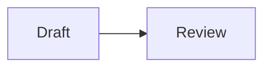

# Mermaid diagram reference · Mermaid 다이어그램 목록

[English authoring guide](document-authoring.md) · [한국어 작성 가이드](document-authoring.ko.md)

NoteHub uses Mermaid 12.3.0. In a Markdown document, use a `mermaid` fence and start the diagram source with the declaration for the type you choose. Copy the declaration exactly, including capitalization and any `-beta` suffix shown. Each row links to the official syntax and an example in the 12.3.0 source.

NoteHub에서 사용하는 버전은 Mermaid 12.3.0입니다. Markdown의 코드 펜스에는 `mermaid`를 적고, 블록 안에는 아래 표에서 고른 선언으로 시작하는 원문을 작성합니다. 대소문자와 `-beta` 접미사를 그대로 사용하세요. 표의 예제 링크는 12.3.0 공식 문서에서 해당 코드로 바로 이동합니다.

````markdown

````

[Official syntax overview · 공식 문법 개요](https://mermaid.js.org/intro/syntax-reference.html) · [Live Editor · 편집기](https://mermaid.live/)

## Flows and interactions · 흐름과 상호작용

| Diagram · 종류 | Declaration · 선언 | Official syntax and examples · 공식 자료 |
| --- | --- | --- |
| Flowchart · 흐름도 | `flowchart` | [Syntax · 문법](https://mermaid.js.org/syntax/flowchart.html) · [Example · 예제](https://github.com/mermaid-js/mermaid/blob/mermaid%4012.3.0/packages/mermaid/src/docs/syntax/flowchart.md#L688-L689) |
| Swimlanes · 역할별 흐름 | `swimlane-beta` | [Syntax · 문법](https://mermaid.js.org/syntax/swimlanes.html) · [Example · 예제](https://github.com/mermaid-js/mermaid/blob/mermaid%4012.3.0/packages/mermaid/src/docs/syntax/swimlanes.md#L136-L140) |
| Sequence · 메시지 순서 | `sequenceDiagram` | [Syntax · 문법](https://mermaid.js.org/syntax/sequenceDiagram.html) · [Example · 예제](https://github.com/mermaid-js/mermaid/blob/mermaid%4012.3.0/packages/mermaid/src/docs/syntax/sequenceDiagram.md#L435-L437) |
| Agentflow · 에이전트 흐름 | `agentflow-beta` | [Syntax · 문법](https://mermaid.js.org/syntax/agentflow.html) · [Example · 예제](https://github.com/mermaid-js/mermaid/blob/mermaid%4012.3.0/packages/mermaid/src/docs/syntax/agentflow.md#L176-L187) |
| Event modeling · 이벤트 모델링 | `eventmodeling` | [Syntax · 문법](https://mermaid.js.org/syntax/eventmodeling.html) · [Example · 예제](https://github.com/mermaid-js/mermaid/blob/mermaid%4012.3.0/packages/mermaid/src/docs/syntax/eventmodeling.md#L42-L46) |
| State · 상태 전이 | `stateDiagram-v2` | [Syntax · 문법](https://mermaid.js.org/syntax/stateDiagram.html) · [Example · 예제](https://github.com/mermaid-js/mermaid/blob/mermaid%4012.3.0/packages/mermaid/src/docs/syntax/stateDiagram.md#L104-L105) |
| User journey · 사용자 여정 | `journey` | [Syntax · 문법](https://mermaid.js.org/syntax/userJourney.html) · [Example · 예제](https://github.com/mermaid-js/mermaid/blob/mermaid%4012.3.0/packages/mermaid/src/docs/syntax/userJourney.md#L12-L20) |

## Software and systems · 소프트웨어와 시스템

| Diagram · 종류 | Declaration · 선언 | Official syntax and examples · 공식 자료 |
| --- | --- | --- |
| Class · 클래스 | `classDiagram` | [Syntax · 문법](https://mermaid.js.org/syntax/classDiagram.html) · [Example · 예제](https://github.com/mermaid-js/mermaid/blob/mermaid%4012.3.0/packages/mermaid/src/docs/syntax/classDiagram.md#L367-L368) |
| Entity relationship · 개체 관계 | `erDiagram` | [Syntax · 문법](https://mermaid.js.org/syntax/entityRelationshipDiagram.html) · [Example · 예제](https://github.com/mermaid-js/mermaid/blob/mermaid%4012.3.0/packages/mermaid/src/docs/syntax/entityRelationshipDiagram.md#L154-L155) |
| Requirements · 요구사항 | `requirementDiagram` | [Syntax · 문법](https://mermaid.js.org/syntax/requirementDiagram.html) · [Example · 예제](https://github.com/mermaid-js/mermaid/blob/mermaid%4012.3.0/packages/mermaid/src/docs/syntax/requirementDiagram.md#L145-L152) |
| Use case · 유스케이스 | `usecase-beta` | [Syntax · 문법](https://mermaid.js.org/syntax/usecase.html) · [Example · 예제](https://github.com/mermaid-js/mermaid/blob/mermaid%4012.3.0/packages/mermaid/src/docs/syntax/usecase.md#L259-L262) |
| Architecture · 아키텍처 | `architecture-beta` | [Syntax · 문법](https://mermaid.js.org/syntax/architecture.html) · [Example · 예제](https://github.com/mermaid-js/mermaid/blob/mermaid%4012.3.0/packages/mermaid/src/docs/syntax/architecture.md#L170-L178) |
| C4 · 시스템 구조와 동작 | `C4Dynamic`, `C4Component`, `C4Container`, `C4Context`, `C4Deployment` | [Syntax · 문법](https://mermaid.js.org/syntax/c4.html) · [C4Dynamic](https://github.com/mermaid-js/mermaid/blob/mermaid%4012.3.0/packages/mermaid/src/docs/syntax/c4.md#L312-L327) · [C4Component](https://github.com/mermaid-js/mermaid/blob/mermaid%4012.3.0/packages/mermaid/src/docs/syntax/c4.md#L270-L305) · [C4Container](https://github.com/mermaid-js/mermaid/blob/mermaid%4012.3.0/packages/mermaid/src/docs/syntax/c4.md#L228-L263) · [C4Context](https://github.com/mermaid-js/mermaid/blob/mermaid%4012.3.0/packages/mermaid/src/docs/syntax/c4.md#L10-L51) · [C4Deployment](https://github.com/mermaid-js/mermaid/blob/mermaid%4012.3.0/packages/mermaid/src/docs/syntax/c4.md#L334-L381) |
| Block · 블록 배치 | `block` | [Syntax · 문법](https://mermaid.js.org/syntax/block.html) · [Example · 예제](https://github.com/mermaid-js/mermaid/blob/mermaid%4012.3.0/packages/mermaid/src/docs/syntax/block.md#L66-L67) |
| Git graph · 브랜치와 커밋 | `gitGraph` | [Syntax · 문법](https://mermaid.js.org/syntax/gitgraph.html) · [Example · 예제](https://github.com/mermaid-js/mermaid/blob/mermaid%4012.3.0/packages/mermaid/src/docs/syntax/gitgraph.md#L55-L58) |
| Packet · 패킷 비트 구조 | `packet` | [Syntax · 문법](https://mermaid.js.org/syntax/packet.html) · [Example · 예제](https://github.com/mermaid-js/mermaid/blob/mermaid%4012.3.0/packages/mermaid/src/docs/syntax/packet.md#L63-L69) |
| Railroad · 문법 규칙 | `railroad-ebnf-beta`, `railroad-abnf-beta`, `railroad-peg-beta`, `railroad-beta` | [Syntax · 문법](https://github.com/mermaid-js/mermaid/blob/mermaid%4012.3.0/packages/mermaid/src/docs/syntax/railroad.md) · [railroad-ebnf-beta](https://github.com/mermaid-js/mermaid/blob/mermaid%4012.3.0/packages/mermaid/src/docs/syntax/railroad.md#L76-L77) · [railroad-abnf-beta](https://github.com/mermaid-js/mermaid/blob/mermaid%4012.3.0/packages/mermaid/src/docs/syntax/railroad.md#L208-L213) · [railroad-peg-beta](https://github.com/mermaid-js/mermaid/blob/mermaid%4012.3.0/packages/mermaid/src/docs/syntax/railroad.md#L241-L246) · [railroad-beta](https://github.com/mermaid-js/mermaid/blob/mermaid%4012.3.0/packages/mermaid/src/docs/syntax/railroad.md#L265-L287) |

## Planning and analysis · 계획과 분석

| Diagram · 종류 | Declaration · 선언 | Official syntax and examples · 공식 자료 |
| --- | --- | --- |
| Gantt · 일정과 의존성 | `gantt` | [Syntax · 문법](https://mermaid.js.org/syntax/gantt.html) · [Example · 예제](https://github.com/mermaid-js/mermaid/blob/mermaid%4012.3.0/packages/mermaid/src/docs/syntax/gantt.md#L296-L298) |
| Timeline · 시점별 사건 | `timeline` | [Syntax · 문법](https://mermaid.js.org/syntax/timeline.html) · [Example · 예제](https://github.com/mermaid-js/mermaid/blob/mermaid%4012.3.0/packages/mermaid/src/docs/syntax/timeline.md#L52-L57) |
| Kanban · 작업 보드 | `kanban` | [Syntax · 문법](https://mermaid.js.org/syntax/kanban.html) · [Example · 예제](https://github.com/mermaid-js/mermaid/blob/mermaid%4012.3.0/packages/mermaid/src/docs/syntax/kanban.md#L14-L16) |
| Mindmap · 마인드맵 | `mindmap` | [Syntax · 문법](https://mermaid.js.org/syntax/mindmap.html) · [Example · 예제](https://github.com/mermaid-js/mermaid/blob/mermaid%4012.3.0/packages/mermaid/src/docs/syntax/mindmap.md#L95-L96) |
| TreeView · 트리 목록 | `treeView-beta` | [Syntax · 문법](https://mermaid.js.org/syntax/treeView.html) · [Example · 예제](https://github.com/mermaid-js/mermaid/blob/mermaid%4012.3.0/packages/mermaid/src/docs/syntax/treeView.md#L219-L223) |
| Ishikawa · 원인과 결과 | `ishikawa-beta` | [Syntax · 문법](https://mermaid.js.org/syntax/ishikawa.html) · [Example · 예제](https://github.com/mermaid-js/mermaid/blob/mermaid%4012.3.0/packages/mermaid/src/docs/syntax/ishikawa.md#L14-L33) |
| Wardley map · 가치사슬과 진화 | `wardley-beta` | [Syntax · 문법](https://mermaid.js.org/syntax/wardley.html) · [Example · 예제](https://github.com/mermaid-js/mermaid/blob/mermaid%4012.3.0/packages/mermaid/src/docs/syntax/wardley.md#L391-L393) |
| Cynefin · 의사결정 맥락 | `cynefin-beta` | [Syntax · 문법](https://mermaid.js.org/syntax/cynefin.html) · [Example · 예제](https://github.com/mermaid-js/mermaid/blob/mermaid%4012.3.0/packages/mermaid/src/docs/syntax/cynefin.md#L153-L159) |

## Charts and sets · 차트와 집합

| Diagram · 종류 | Declaration · 선언 | Official syntax and examples · 공식 자료 |
| --- | --- | --- |
| Pie · 구성 비율 | `pie` | [Syntax · 문법](https://mermaid.js.org/syntax/pie.html) · [Example · 예제](https://github.com/mermaid-js/mermaid/blob/mermaid%4012.3.0/packages/mermaid/src/docs/syntax/pie.md#L13-L16) |
| XY chart · 막대와 선 | `xychart` | [Syntax · 문법](https://mermaid.js.org/syntax/xyChart.html) · [Example · 예제](https://github.com/mermaid-js/mermaid/blob/mermaid%4012.3.0/packages/mermaid/src/docs/syntax/xyChart.md#L254-L258) |
| Quadrant · 사분면 | `quadrantChart` | [Syntax · 문법](https://mermaid.js.org/syntax/quadrantChart.html) · [Example · 예제](https://github.com/mermaid-js/mermaid/blob/mermaid%4012.3.0/packages/mermaid/src/docs/syntax/quadrantChart.md#L12-L25) |
| Sankey · 흐름의 양 | `sankey` | [Syntax · 문법](https://mermaid.js.org/syntax/sankey.html) · [Example · 예제](https://github.com/mermaid-js/mermaid/blob/mermaid%4012.3.0/packages/mermaid/src/docs/syntax/sankey.md#L120-L126) |
| Radar · 다축 비교 | `radar-beta` | [Syntax · 문법](https://mermaid.js.org/syntax/radar.html) · [Example · 예제](https://github.com/mermaid-js/mermaid/blob/mermaid%4012.3.0/packages/mermaid/src/docs/syntax/radar.md#L50-L61) |
| Treemap · 면적으로 보는 계층 | `treemap-beta` | [Syntax · 문법](https://mermaid.js.org/syntax/treemap.html) · [Example · 예제](https://github.com/mermaid-js/mermaid/blob/mermaid%4012.3.0/packages/mermaid/src/docs/syntax/treemap.md#L49-L55) |
| Venn · 집합과 교집합 | `venn-beta` | [Syntax · 문법](https://mermaid.js.org/syntax/venn.html) · [Example · 예제](https://github.com/mermaid-js/mermaid/blob/mermaid%4012.3.0/packages/mermaid/src/docs/syntax/venn.md#L82-L85) |

## Alternate declarations · 추가 선언

The following declarations also rendered in NoteHub’s frame. · 다음 선언도 같은 계열의 그림을 표시합니다.

| Preferred · 기본 선언 | Also accepted · 추가 선언 |
| --- | --- |
| `flowchart` | `graph`, `flowchart-elk` |
| `classDiagram` | `classDiagram-v2` |
| `stateDiagram-v2` | `stateDiagram` |
| `block` | `block-beta` |
| `packet` | `packet-beta` |
| `sankey` | `sankey-beta` |
| `xychart` | `xychart-beta` |
| `ishikawa-beta` | `ishikawa` |
| `treemap-beta` | `treemap` |

## Renderer scope · 적용 범위

- `info` displays Mermaid version information. · `info`는 Mermaid 버전 정보를 표시합니다.

- ZenUML requires a separate plugin. NoteHub 12.3.0-based previews support the built-in `sequenceDiagram` syntax for message exchanges. · 현재 NoteHub 렌더러에는 ZenUML 플러그인이 등록되어 있지 않습니다. 메시지 흐름은 `sequenceDiagram`으로 작성하세요. [ZenUML](https://mermaid.js.org/syntax/zenuml.html)
