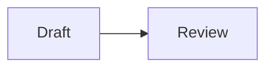

# Mermaid diagram reference

[Document authoring guide](document-authoring.md)

NoteHub uses Mermaid 12.3.0. In a Markdown document, use a `mermaid` fence and start the diagram source with the declaration for the type you choose. Copy the declaration exactly, including capitalization and any `-beta` suffix shown. Each row links to the official syntax and an example in the 12.3.0 source.

````markdown

````

[Official syntax overview](https://mermaid.js.org/intro/syntax-reference.html) · [Live Editor](https://mermaid.live/)

## Flows and interactions

| Diagram | Declaration | Official syntax and examples |
| --- | --- | --- |
| Flowchart | `flowchart` | [Syntax](https://mermaid.js.org/syntax/flowchart.html) · [Example](https://github.com/mermaid-js/mermaid/blob/mermaid%4012.3.0/packages/mermaid/src/docs/syntax/flowchart.md#L688-L689) |
| Swimlanes | `swimlane-beta` | [Syntax](https://mermaid.js.org/syntax/swimlanes.html) · [Example](https://github.com/mermaid-js/mermaid/blob/mermaid%4012.3.0/packages/mermaid/src/docs/syntax/swimlanes.md#L136-L140) |
| Sequence | `sequenceDiagram` | [Syntax](https://mermaid.js.org/syntax/sequenceDiagram.html) · [Example](https://github.com/mermaid-js/mermaid/blob/mermaid%4012.3.0/packages/mermaid/src/docs/syntax/sequenceDiagram.md#L435-L437) |
| Agentflow | `agentflow-beta` | [Syntax](https://mermaid.js.org/syntax/agentflow.html) · [Example](https://github.com/mermaid-js/mermaid/blob/mermaid%4012.3.0/packages/mermaid/src/docs/syntax/agentflow.md#L176-L187) |
| Event modeling | `eventmodeling` | [Syntax](https://mermaid.js.org/syntax/eventmodeling.html) · [Example](https://github.com/mermaid-js/mermaid/blob/mermaid%4012.3.0/packages/mermaid/src/docs/syntax/eventmodeling.md#L42-L46) |
| State | `stateDiagram-v2` | [Syntax](https://mermaid.js.org/syntax/stateDiagram.html) · [Example](https://github.com/mermaid-js/mermaid/blob/mermaid%4012.3.0/packages/mermaid/src/docs/syntax/stateDiagram.md#L104-L105) |
| User journey | `journey` | [Syntax](https://mermaid.js.org/syntax/userJourney.html) · [Example](https://github.com/mermaid-js/mermaid/blob/mermaid%4012.3.0/packages/mermaid/src/docs/syntax/userJourney.md#L12-L20) |

## Software and systems

| Diagram | Declaration | Official syntax and examples |
| --- | --- | --- |
| Class | `classDiagram` | [Syntax](https://mermaid.js.org/syntax/classDiagram.html) · [Example](https://github.com/mermaid-js/mermaid/blob/mermaid%4012.3.0/packages/mermaid/src/docs/syntax/classDiagram.md#L367-L368) |
| Entity relationship | `erDiagram` | [Syntax](https://mermaid.js.org/syntax/entityRelationshipDiagram.html) · [Example](https://github.com/mermaid-js/mermaid/blob/mermaid%4012.3.0/packages/mermaid/src/docs/syntax/entityRelationshipDiagram.md#L154-L155) |
| Requirements | `requirementDiagram` | [Syntax](https://mermaid.js.org/syntax/requirementDiagram.html) · [Example](https://github.com/mermaid-js/mermaid/blob/mermaid%4012.3.0/packages/mermaid/src/docs/syntax/requirementDiagram.md#L145-L152) |
| Use case | `usecase-beta` | [Syntax](https://mermaid.js.org/syntax/usecase.html) · [Example](https://github.com/mermaid-js/mermaid/blob/mermaid%4012.3.0/packages/mermaid/src/docs/syntax/usecase.md#L259-L262) |
| Architecture | `architecture-beta` | [Syntax](https://mermaid.js.org/syntax/architecture.html) · [Example](https://github.com/mermaid-js/mermaid/blob/mermaid%4012.3.0/packages/mermaid/src/docs/syntax/architecture.md#L170-L178) |
| C4 | `C4Dynamic`, `C4Component`, `C4Container`, `C4Context`, `C4Deployment` | [Syntax](https://mermaid.js.org/syntax/c4.html) · [C4Dynamic](https://github.com/mermaid-js/mermaid/blob/mermaid%4012.3.0/packages/mermaid/src/docs/syntax/c4.md#L312-L327) · [C4Component](https://github.com/mermaid-js/mermaid/blob/mermaid%4012.3.0/packages/mermaid/src/docs/syntax/c4.md#L270-L305) · [C4Container](https://github.com/mermaid-js/mermaid/blob/mermaid%4012.3.0/packages/mermaid/src/docs/syntax/c4.md#L228-L263) · [C4Context](https://github.com/mermaid-js/mermaid/blob/mermaid%4012.3.0/packages/mermaid/src/docs/syntax/c4.md#L10-L51) · [C4Deployment](https://github.com/mermaid-js/mermaid/blob/mermaid%4012.3.0/packages/mermaid/src/docs/syntax/c4.md#L334-L381) |
| Block | `block` | [Syntax](https://mermaid.js.org/syntax/block.html) · [Example](https://github.com/mermaid-js/mermaid/blob/mermaid%4012.3.0/packages/mermaid/src/docs/syntax/block.md#L66-L67) |
| Git graph | `gitGraph` | [Syntax](https://mermaid.js.org/syntax/gitgraph.html) · [Example](https://github.com/mermaid-js/mermaid/blob/mermaid%4012.3.0/packages/mermaid/src/docs/syntax/gitgraph.md#L55-L58) |
| Packet | `packet` | [Syntax](https://mermaid.js.org/syntax/packet.html) · [Example](https://github.com/mermaid-js/mermaid/blob/mermaid%4012.3.0/packages/mermaid/src/docs/syntax/packet.md#L63-L69) |
| Railroad | `railroad-ebnf-beta`, `railroad-abnf-beta`, `railroad-peg-beta`, `railroad-beta` | [Syntax](https://github.com/mermaid-js/mermaid/blob/mermaid%4012.3.0/packages/mermaid/src/docs/syntax/railroad.md) · [railroad-ebnf-beta](https://github.com/mermaid-js/mermaid/blob/mermaid%4012.3.0/packages/mermaid/src/docs/syntax/railroad.md#L76-L77) · [railroad-abnf-beta](https://github.com/mermaid-js/mermaid/blob/mermaid%4012.3.0/packages/mermaid/src/docs/syntax/railroad.md#L208-L213) · [railroad-peg-beta](https://github.com/mermaid-js/mermaid/blob/mermaid%4012.3.0/packages/mermaid/src/docs/syntax/railroad.md#L241-L246) · [railroad-beta](https://github.com/mermaid-js/mermaid/blob/mermaid%4012.3.0/packages/mermaid/src/docs/syntax/railroad.md#L265-L287) |

## Planning and analysis

| Diagram | Declaration | Official syntax and examples |
| --- | --- | --- |
| Gantt | `gantt` | [Syntax](https://mermaid.js.org/syntax/gantt.html) · [Example](https://github.com/mermaid-js/mermaid/blob/mermaid%4012.3.0/packages/mermaid/src/docs/syntax/gantt.md?plain=1#L24-L32) |
| Timeline | `timeline` | [Syntax](https://mermaid.js.org/syntax/timeline.html) · [Example](https://github.com/mermaid-js/mermaid/blob/mermaid%4012.3.0/packages/mermaid/src/docs/syntax/timeline.md#L52-L57) |
| Kanban | `kanban` | [Syntax](https://mermaid.js.org/syntax/kanban.html) · [Example](https://github.com/mermaid-js/mermaid/blob/mermaid%4012.3.0/packages/mermaid/src/docs/syntax/kanban.md#L14-L16) |
| Mindmap | `mindmap` | [Syntax](https://mermaid.js.org/syntax/mindmap.html) · [Example](https://github.com/mermaid-js/mermaid/blob/mermaid%4012.3.0/packages/mermaid/src/docs/syntax/mindmap.md#L95-L96) |
| TreeView | `treeView-beta` | [Syntax](https://mermaid.js.org/syntax/treeView.html) · [Example](https://github.com/mermaid-js/mermaid/blob/mermaid%4012.3.0/packages/mermaid/src/docs/syntax/treeView.md#L219-L223) |
| Ishikawa | `ishikawa-beta` | [Syntax](https://mermaid.js.org/syntax/ishikawa.html) · [Example](https://github.com/mermaid-js/mermaid/blob/mermaid%4012.3.0/packages/mermaid/src/docs/syntax/ishikawa.md#L14-L33) |
| Wardley map | `wardley-beta` | [Syntax](https://mermaid.js.org/syntax/wardley.html) · [Example](https://github.com/mermaid-js/mermaid/blob/mermaid%4012.3.0/packages/mermaid/src/docs/syntax/wardley.md?plain=1#L30-L49) |
| Cynefin | `cynefin-beta` | [Syntax](https://mermaid.js.org/syntax/cynefin.html) · [Example](https://github.com/mermaid-js/mermaid/blob/mermaid%4012.3.0/packages/mermaid/src/docs/syntax/cynefin.md#L153-L159) |

## Charts and sets

| Diagram | Declaration | Official syntax and examples |
| --- | --- | --- |
| Pie | `pie` | [Syntax](https://mermaid.js.org/syntax/pie.html) · [Example](https://github.com/mermaid-js/mermaid/blob/mermaid%4012.3.0/packages/mermaid/src/docs/syntax/pie.md#L13-L16) |
| XY chart | `xychart` | [Syntax](https://mermaid.js.org/syntax/xyChart.html) · [Example](https://github.com/mermaid-js/mermaid/blob/mermaid%4012.3.0/packages/mermaid/src/docs/syntax/xyChart.md#L254-L258) |
| Quadrant | `quadrantChart` | [Syntax](https://mermaid.js.org/syntax/quadrantChart.html) · [Example](https://github.com/mermaid-js/mermaid/blob/mermaid%4012.3.0/packages/mermaid/src/docs/syntax/quadrantChart.md#L12-L25) |
| Sankey | `sankey` | [Syntax](https://mermaid.js.org/syntax/sankey.html) · [Example](https://github.com/mermaid-js/mermaid/blob/mermaid%4012.3.0/packages/mermaid/src/docs/syntax/sankey.md#L120-L126) |
| Radar | `radar-beta` | [Syntax](https://mermaid.js.org/syntax/radar.html) · [Example](https://github.com/mermaid-js/mermaid/blob/mermaid%4012.3.0/packages/mermaid/src/docs/syntax/radar.md#L50-L61) |
| Treemap | `treemap-beta` | [Syntax](https://mermaid.js.org/syntax/treemap.html) · [Example](https://github.com/mermaid-js/mermaid/blob/mermaid%4012.3.0/packages/mermaid/src/docs/syntax/treemap.md#L49-L55) |
| Venn | `venn-beta` | [Syntax](https://mermaid.js.org/syntax/venn.html) · [Example](https://github.com/mermaid-js/mermaid/blob/mermaid%4012.3.0/packages/mermaid/src/docs/syntax/venn.md#L82-L85) |

## Alternate declarations

The following declarations also rendered in NoteHub’s frame.

| Preferred | Also accepted |
| --- | --- |
| `flowchart` | `graph`, `flowchart-elk` |
| `classDiagram` | `classDiagram-v2` |
| `stateDiagram-v2` | `stateDiagram` |
| `block` | `block-beta` |
| `packet` | `packet-beta` |
| `sankey` | `sankey-beta` |
| `xychart` | `xychart-beta` |
| `ishikawa-beta` | `ishikawa` |
| `treemap-beta` | `treemap` |

## Renderer scope

- `info` displays Mermaid version information.

- ZenUML requires a separate plugin. NoteHub 12.3.0-based previews support the built-in `sequenceDiagram` syntax for message exchanges. [ZenUML](https://mermaid.js.org/syntax/zenuml.html)
